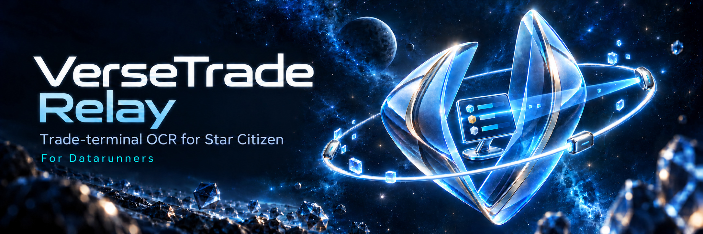

# VerseTrade Relay

**Star Citizenの交易端末画像**を読み取り、内容を確認・修正して**UEX**へ報告するWindowsアプリです。

[English](README.md) · [ダウンロード](https://github.com/nakacch/VerseTrade-Relay/releases) ·
[簡易マニュアル](docs/QUICKSTART.ja.md) · [不具合報告](https://github.com/nakacch/VerseTrade-Relay/issues)

## 主な機能

- スクリーンショットフォルダーを監視し、撮影した画像を自動で読み取り。
  画像を選択して取り込んだり、ドラッグ＆ドロップしたりすることもできます。
- ゲームの言語に合わせたモデルによるローカルOCR。
- 翻訳ファイル`global.ini`の内容から、地名・アイテム名をUEXの情報と自動で紐づけ。
  `global.ini`の変更にも自動で追従します。
- 元画像・切り出しを見ながら商品、価格、在庫、状態、貨物サイズを編集。
- OCR確度が低い値は文字色で、UEXの価格・在庫との乖離は色付きの枠と差分値で見やすく表示。
- テスト送信、本番送信、送信履歴。
- 日本語・英語のUIとSystem / Light / Dark / Slateのテーマ。

## ダウンロードと動作条件

1. [Releases](https://github.com/nakacch/VerseTrade-Relay/releases)を開きます。
2. **Assets**から**`VerseTrade-Relay.exe`**を取得します。
3. 好きなフォルダーに保存し、ダブルクリックして起動します。

GitHubが自動生成する**Source code**には文書と画像のみが含まれます。アプリはEXEを取得してください。
**Pre-release**と表示される版は試行版です。

64bit版Windows 10/11、OpenGL対応のグラフィックスドライバー、
[Microsoft Visual C++ x64再頒布可能パッケージ](https://learn.microsoft.com/ja-jp/cpp/windows/latest-supported-vc-redist)が必要です。
コード署名はしていません。
モデル取得やUEXの利用にはインターネット接続が必要です。

## 単一実行ファイルについて

EXEを1つ取得して起動できます。必要な補助ファイルはユーザーデータ内へ自動的に準備します。
**OCRモデルは同梱しません**。ウェルカムページまたは「設定 → 読み取り」から、
使用する言語のモデルを選んで取得してください。

本アプリは、速度と認識精度を重視した**ONNX方式のOCRを主に使用する前提**で作成しています。
ONNXの動作に必要な機能はEXEに含まれています。使用するモデルは、アプリ内のウェルカムページや
「設定 → 読み取り」から選択してダウンロードできます。
Tesseractは任意の代替方式で、別途インストールが必要です。
速度・精度はモデル、言語、画像の状態によって変わります。

マニュアルはこのGitHubで閲覧できます。第三者ライセンスはEXE内に含め、起動時にキャッシュへ保存します。
ファイルの一致を確認したい場合は、任意で`.exe.sha256`も取得できます。

## 初回設定

1. ウェルカムページでLIVEまたはPTUを選び、その環境で使用する言語の翻訳ファイル
   `global.ini`を指定して、読み取り言語を確認します。
2. アプリ内のウェルカムページまたは「設定 → 読み取り」で、使用するモデルを選び「取得・検証」を実行します。
3. 「設定 → UEX接続」で商品・端末カタログを更新します。
4. ゲームのスクリーンショット保存先を監視フォルダーに指定し、LIVE/PTUを確認して保存します。
   「連続画像を自動で読み取る」は有効にしておきます。
5. **ゲーム内の交易端末**で、**左側の「場所」をステーション名**にします。
   **同じ端末の右側の商品リストをスクロールしながら**、スクリーンショットを撮影します。
6. アプリが監視フォルダーの新しい画像を自動で読み取ります。通常は、アプリ上で端末を選択したり、
   画像を手動で取り込んだりする必要はありません。結果を元画像と照合し、必要に応じて修正します。
7. 送信モードと画像添付を確認します。初期状態のテスト先行モードでは、
   テスト成功後に本番送信を確認・実行します。

操作、結果不明時の対応、更新は[簡易マニュアル](docs/QUICKSTART.ja.md)を参照してください。

## 保存先と通信

OCRはPC内で実行します。通信はモデル取得、UEXカタログ・参照値取得、要求した更新取得、
UEXへの報告・状態照会に使います。画像添付を有効にして送信すると元画像がUEXへ送られます。

| 内容 | 標準の保存先 |
| --- | --- |
| 設定・履歴・ログ | `%APPDATA%\VerseTrade-Relay\` |
| ダウンロードしたONNXモデル | `%APPDATA%\VerseTrade-Relay\ocr-models\` |
| 画像の作業用コピー・補助ファイル | `%LOCALAPPDATA%\VerseTrade-Relay\cache\` |

利用者のUEXシークレットキーはWindowsユーザーに紐づけて暗号化します。
作業用画像がキャッシュに残る場合があります。EXEの更新・削除だけでは上記フォルダーは消えません。
初期化前にマニュアルを確認してください。

## 制限事項

- OCRは誤読する場合があります。端末、環境、方向、各値を確認してから送信してください。
- 通信障害で本番結果が不明になる場合があります。再送前に履歴で照合してください。自動再送しません。
- ゲーム内の操作を自動化する機能はありません。
- 初回リリースは配布手順の試行版です。実UEX送信や全言語・Windows環境の受け入れ試験済みを意味しません。

## 不具合・要望

[Issues](https://github.com/nakacch/VerseTrade-Relay/issues)へ日本語または英語でお願いします。
アプリ版、Windows版、UI・ゲーム言語、OCRエンジンとモデル、再現手順、期待と実際の結果を記載してください。
秘密キー、個人パス、画像の識別情報は除いてください。設定ファイルや履歴DBをそのまま添付しないでください。

## 配布と謝辞

このリポジトリは利用者向け文書とリリース情報の掲載先です。アプリのソースは別の開発用リポジトリで管理し、
ここでは公開しません。アプリ自体にオープンソースライセンスは適用していません。
第三者コンポーネントには各ライセンスが適用されます。[説明](docs/THIRD_PARTY.md)を参照してください。
全文はローカルアプリデータ内の`cache\bundled\<payload-hash>\THIRD-PARTY-NOTICES.txt`に保存します。
Windowsフォント、ゲーム画像、言語ファイルは再配布しません。Star CitizenやUEXの公式製品ではありません。
