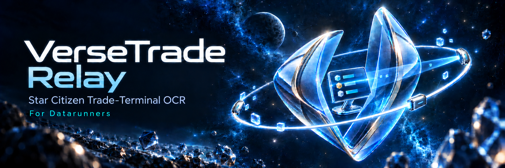
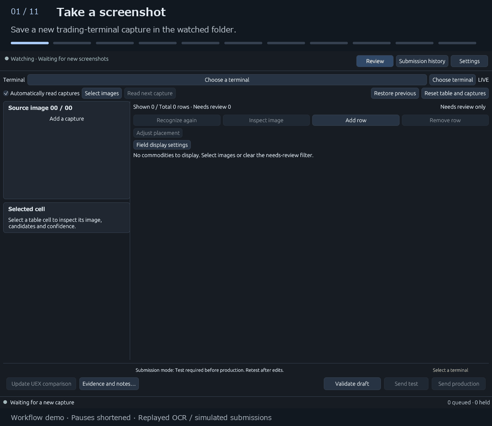

# VerseTrade Relay

A Windows desktop app for reading **Star Citizen trading-terminal screenshots**,
reviewing the results, and reporting commodity prices and stock to **UEX**.

[日本語](README.ja.md) · [Download](https://github.com/nakacch/VerseTrade-Relay/releases) ·
[Quick start](docs/QUICKSTART.md) · [Report an issue](https://github.com/nakacch/VerseTrade-Relay/issues)

[0.6.2 preview](https://github.com/nakacch/VerseTrade-Relay/releases/tag/v0.6.2)
temporarily disables all automatically added report comments. Your own notes are preserved.

## See it in action

**Capture continuously → build the list → inspect evidence → test (optional) → submit.**

Testing can be skipped depending on the submission mode. The default test-first
mode requires a successful test.

When the next capture is recognized as the same terminal, new commodities are
added to the current list. Hover individual cells to see their supporting image
crops and OCR confidence, or select a cell for the persistent detail pane.

Edited workflow demo: waiting time is shortened, local OCR results are replayed,
and submission responses/history are simulated. No report was sent to UEX.
The app's real test and production actions both contact UEX.
Prefer still images? See the [illustrated quick start](docs/QUICKSTART.md#2-read-and-review).

## Features

- Watch your screenshot folder and automatically read new captures as you take them.
  You can also import screenshots or drag and drop them onto the app.
- Run OCR locally using models selected for your game language.
- Automatically match localized place and item names to UEX using your game's
  translation file, `global.ini`, and follow changes to that file automatically.
- Check source images and field crops while editing commodities, prices, stock,
  inventory status and cargo sizes.
- Spot low OCR confidence through text colors and differences from UEX reference
  prices/stock through colored borders and difference values.
- Identify reporter edits with pencil markers and inspect the reasons locally.
  Automatic report comments are temporarily disabled in 0.6.2; your own notes are preserved.
- Optional test reports (depending on submission mode), production submission and history.
- English/Japanese interface; System, Light, Dark and Slate themes.

## Download and requirements

1. Open [Releases](https://github.com/nakacch/VerseTrade-Relay/releases).
2. Download **`VerseTrade-Relay.exe`** from **Assets**.
3. Save it in a folder of your choice and double-click it to start.

GitHub's **Source code** archives contain documentation and artwork only. Use the release
EXE for the app. Releases marked **Pre-release** are preview builds.

Requirements: 64-bit Windows 10/11, an OpenGL-capable graphics driver,
and the [Microsoft Visual C++ x64 Redistributable](https://learn.microsoft.com/en-us/cpp/windows/latest-supported-vc-redist).
The app is unsigned. Internet access is required for model downloads and UEX services.

## Single executable

Download and run one EXE. Required support files are prepared automatically in
your user data folder. **OCR models are not bundled**:
select and download them for your language in the welcome page or **Settings → OCR**.

The app is designed primarily for **ONNX-based OCR**, with speed and recognition
accuracy in mind. Required ONNX support is included in the EXE. Choose and download
models directly inside the app, from welcome setup or **Settings → OCR**.
Tesseract is an optional alternative and requires a separate installation.
Speed and accuracy depend on the model, language and image.

Read the manuals here on GitHub. Third-party license notices are included inside
the EXE and saved in the app cache at startup. An optional `.exe.sha256` download
lets you verify the executable.

## First run

1. In welcome setup, choose LIVE or PTU and select that installation's translation
   file (`global.ini`) for your game language, then check the OCR language.
   Bundled English vocabulary is used when no external file is available.
2. In the app's welcome setup or **Settings → OCR**, select your models and use
   **download and verify**.
   OCR settings offer automatic/manual reading languages and **Configure language models…**
   for separate per-language model choices. Apply dialog edits, then save settings.
3. Refresh the commodity/terminal catalog in **Settings → UEX connection**.
4. Set the watch folder to the folder where your game saves screenshots, confirm
   LIVE/PTU, and save settings. Leave **Automatically read captures** enabled.
5. On the **in-game trading terminal**, set the **location field on the left** to
   the station name. Take screenshots while scrolling through the **commodity list
   on the right**, staying at the same terminal.
6. The app automatically reads the new screenshots from the watched folder.
   Normally, you do not need to select a terminal in the app or import images
   manually. Check the results against the images and correct them as needed.
7. Check the submission mode and the supporting screenshot. Screenshot attachments
   are required for reports, including test submissions, and cannot be disabled.
   In the default test-first
   mode, pass a test before confirming production submission. To skip testing,
   select **Test optional** or **Production only** in **Settings → Sending** and save.

See the [quick start](docs/QUICKSTART.md) for editing, recovery and updates.

## Data and privacy

OCR runs locally. Network access is used for model downloads, UEX catalog/reference
queries, startup/periodic update checks, requested update downloads and UEX
report/status requests. Each report, including
a test submission, sends its supporting screenshot to UEX. The attachment uses
the original capture, converted to JPEG, rather than the image corrected for OCR.

| Data | Default location |
| --- | --- |
| Settings, history and logs | `%APPDATA%\VerseTrade-Relay\` |
| Downloaded ONNX models | `%APPDATA%\VerseTrade-Relay\ocr-models\` |
| Cache and support files | `%LOCALAPPDATA%\VerseTrade-Relay\cache\` |

Your UEX user secret is protected by **Windows data protection**.
The app references your original screenshot files. Keep them available and unchanged
until submission. Earlier versions may have left image copies in the cache.
Replacing/deleting the EXE does not remove these folders. See the manual before resetting app data.

## Limitations

- OCR can misread values. Check the terminal, environment, direction and every
  value before sending; ambiguous readings need manual review.
- A production result may be unknown after connection failure. Reconcile it in
  history before retrying. Unknown results are not automatically resent.
- The app does not automate in-game actions.
- This preview has not been validated with live UEX submission or across every
  language and Windows environment.

## Issues and feature requests

Use [this repository's Issues](https://github.com/nakacch/VerseTrade-Relay/issues).
English and Japanese are welcome. Include app/Windows version, UI/game language,
OCR engine/model, reproduction steps and expected/actual results. Remove secrets,
personal paths and identifying screenshot details. Do not upload unchanged
settings files or submission-history databases.

## Distribution and acknowledgments

This repository contains user documentation and release metadata. Application
source is maintained separately and is not published here. The application is
not offered under an open-source license. Third-party components retain their
own licenses; see [notices](docs/THIRD_PARTY.md). Full license texts are saved as
`cache\bundled\<payload-hash>\THIRD-PARTY-NOTICES.txt` under the local app data folder.
Windows font files, original game captures and localization files are not bundled.
The walkthrough shows a maintainer-provided Star Citizen capture inside the app;
game imagery belongs to its respective rights holders.
This is an independent community tool, not an official Star Citizen or UEX product.
