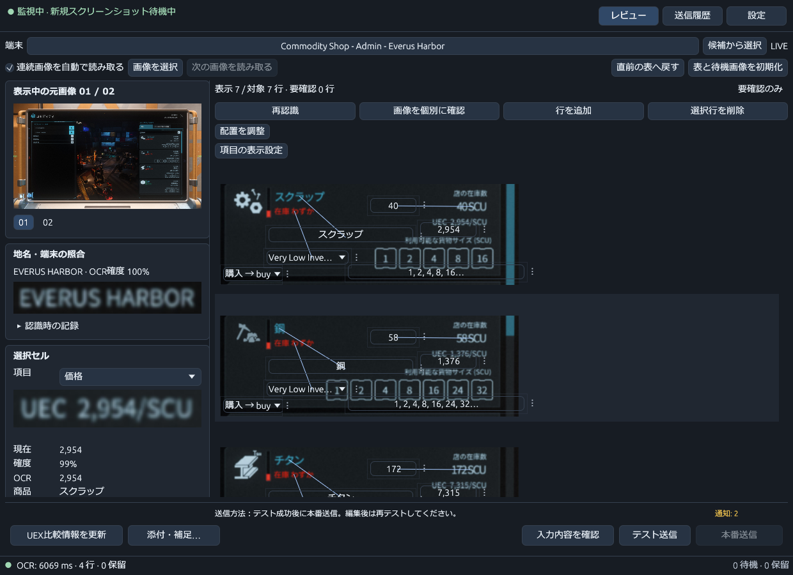
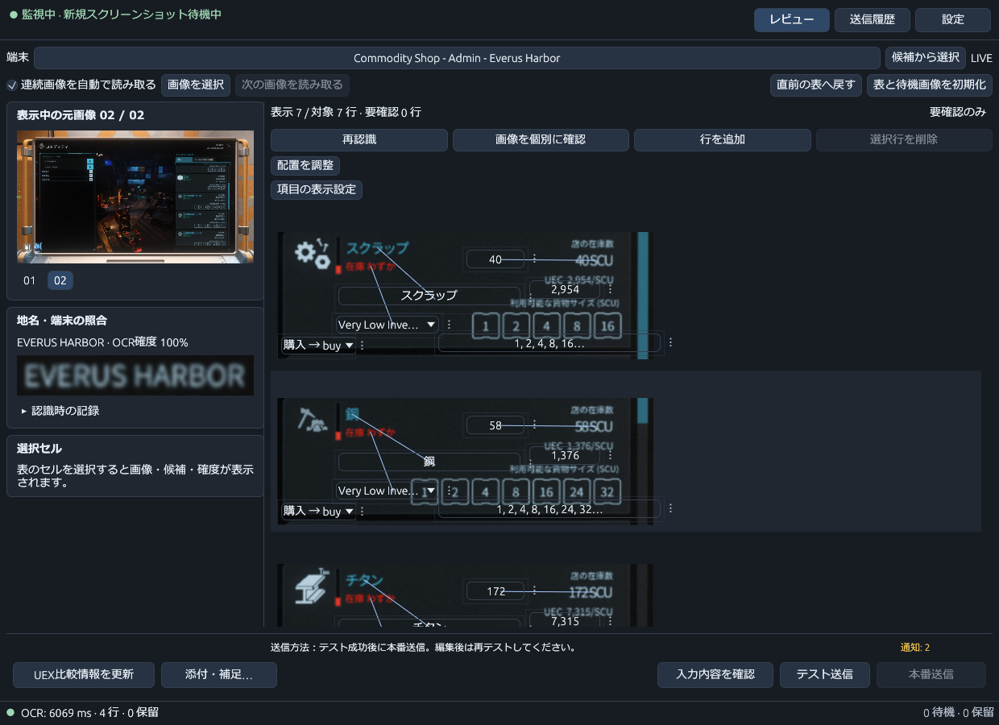
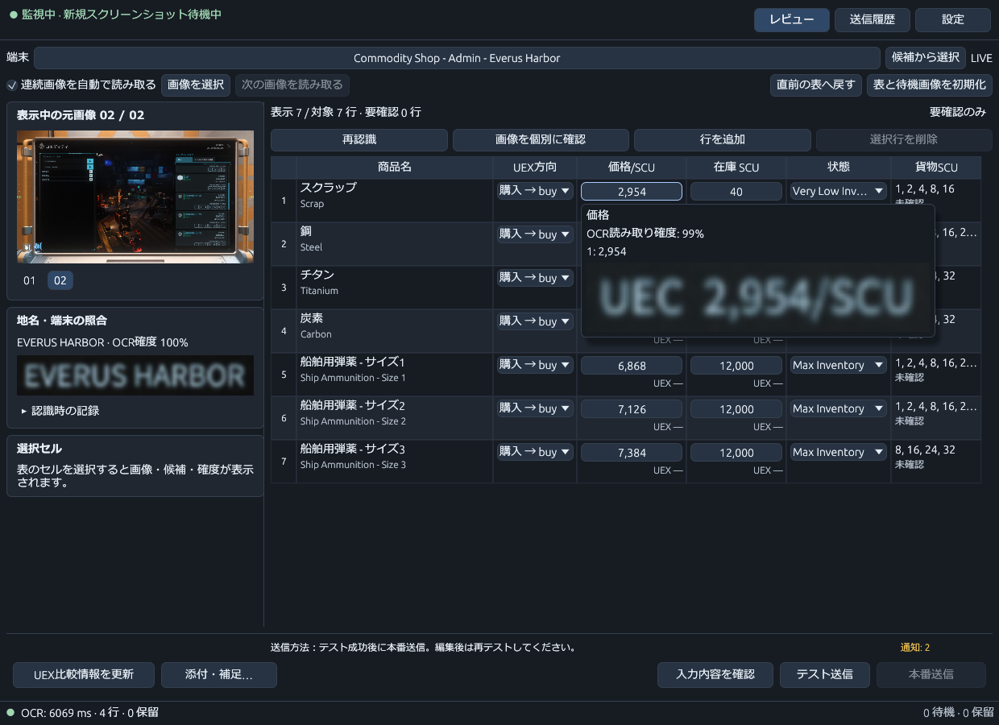
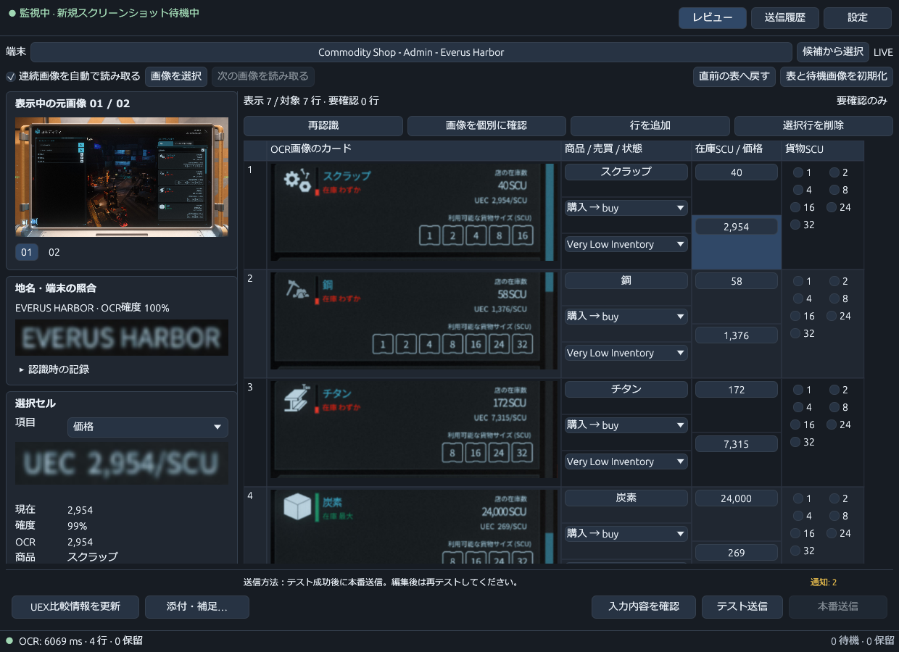
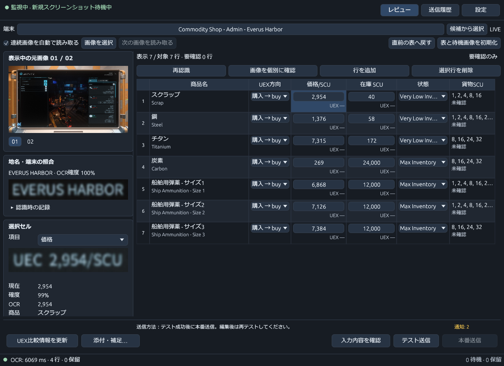
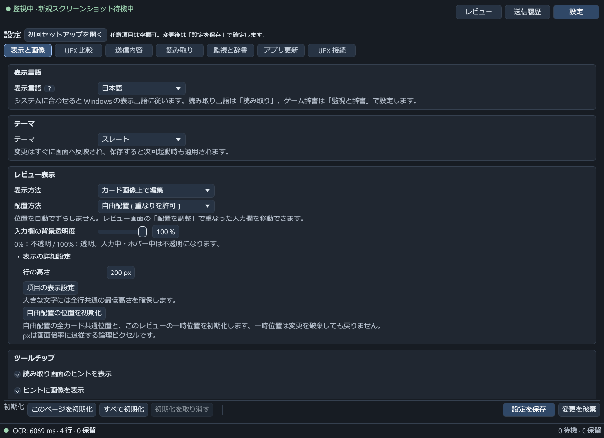
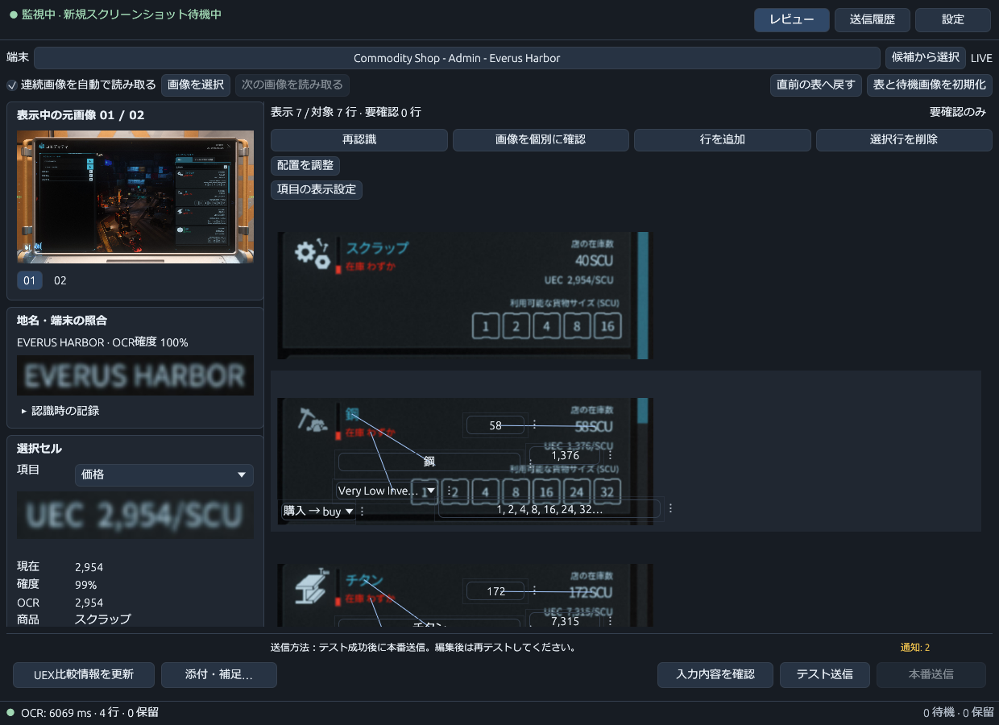
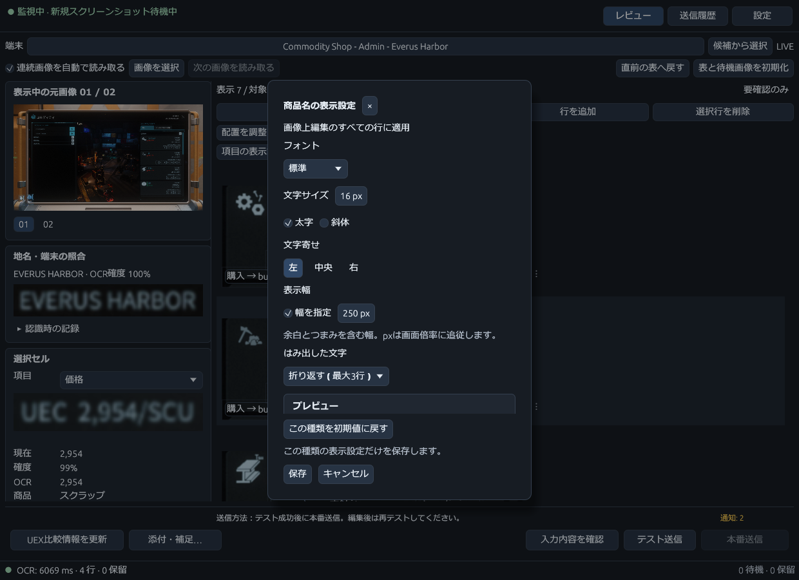
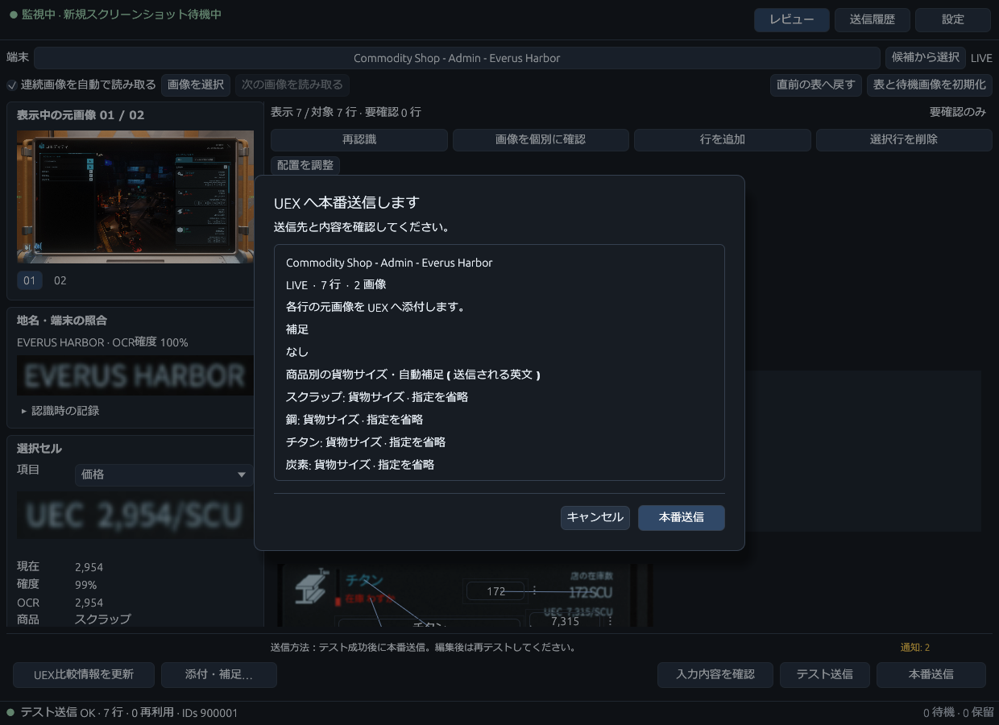
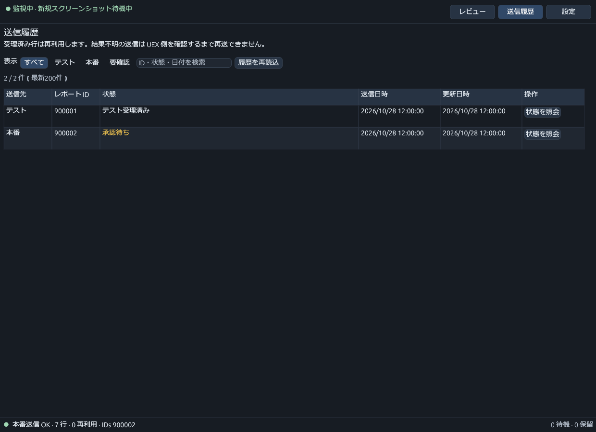

# 簡易マニュアル

[README](../README.ja.md) · [English](QUICKSTART.md)

このガイドは**0.6.8**の操作を説明しています。
**STANTON星系の一部の赤系交易端末**と**Pyro星系のオレンジ系交易端末**に仮対応しています。
対応範囲は限定的です。送信前に商品名・価格・在庫・貨物サイズを元画像と照合してください。

## 1. 導入と初期設定

[Releases](https://github.com/nakacch/VerseTrade-Relay/releases)から`VerseTrade-Relay.exe`を取得し、
ダブルクリックして起動します。必要な補助ファイルとライセンスはユーザーデータ内に自動で準備します。
Microsoft Visual C++ x64ランタイムは導入済みであることを前提とします。

ウェルカムページで、普段プレイする環境（**LIVE**または**PTU**）を選びます。
「標準のゲーム保存先を検索」または「ゲームフォルダーから探す」で、インストール済みのゲームの
翻訳ファイルを探してください。「LIVE global.ini」または「PTU global.ini」には、その環境で
使用している言語の`global.ini`を指定します。保存場所の例は
`<ゲームのインストール先>/data/Localization/<言語>/global.ini`です。

使用する環境に外部の`global.ini`がない場合は、内蔵の英語語彙を使用します。
別のゲーム言語を使う場合は、その言語のファイルを指定してください。
使わない環境の欄は空欄で構いません。

アプリはこの翻訳ファイルの内容から地名・アイテム名をUEXの情報と紐づけ、
起動中のファイル変更にも自動で追従します。UIの表示言語とゲーム・OCRの言語は別の設定です。
OCRはONNX方式を推奨します。アプリ内のウェルカムページまたは「設定 → 読み取り」で、
使用する言語に適したモデルを選び、「取得・検証」を実行してください。

「設定 → 読み取り」では、使用中の辞書からの自動判定か、読み取り言語の手動指定を選べます。
「言語別のモデル設定…」で言語ごとの設定を開きます。この画面の対象言語を切り替えても、
実際の読み取り言語は変わりません。ONNX／Tesseract、モデルの取得・検証や外部Tesseractモデルを
設定して「設定画面に反映」、続いて「設定を保存」で確定します。
「この言語の設定を初期化」は対象言語のモデル選択だけを戻し、「キャンセル」はダイアログ内の
編集を破棄します。モデルを取得しただけでは設定は保存されません。

ONNXの動作に必要な機能はEXEに含まれており、モデルもアプリ内でダウンロードできます。
初回セットアップは設定から再表示できます。

「設定 → UEX接続」で商品・端末カタログを更新します。**UEXのユーザーシークレット**は、
**UEXへレポートを送信する際に必要**です。送信する場合は「設定 → UEX接続」に登録してください。
公開の商品・端末カタログの取得には不要です。
ゲームのスクリーンショット保存先を**監視フォルダー**に指定し、
環境と、必要ならゲーム版を確認して保存します。
保存とモデル取得・カタログ更新は別操作です。保存だけではモデルを取得しません。

## 2. 読み取りとレビュー

### 初期表示と画面の見方



初回起動時は**「カード画像上で編集」**です。商品カードの画像上に、商品名、価格、在庫、
売買方向、在庫状態、貨物サイズの操作欄を表示します。配置は**自由配置**、入力欄の背景透明度は
**100%**、行高は**200px**です。保存済みの表示方法・配置・書式は引き継ぎます。
透明な欄にカーソルを重ねるかフォーカスすると、背景が不透明になって読みやすくなります。

画面上部で端末・LIVE/PTUと監視状態を確認します。左上は閲覧中の元画像、左下は選択した項目の
切り出し・OCR値・観測候補・編集欄です。右側は商品一覧で、入りきらない行は縦スクロールします。
左の詳細欄は独立してスクロールできます。入力確認・送信操作は下部に固定されています。
端末が違う場合は、上部の端末名か「候補から選択」を押します。候補は左揃えで、名前の異なる部分を
強調します。自動判定が正しければ、選び直す必要はありません。

### 連続撮影と値の確認



この例では、1枚目の撮影画像から**Everus Harborの4商品**が一覧に表示されます。
ゲーム内の商品リストをスクロールして続けて撮影すると、同じ端末と認識された画像の商品が
現在のリストに自動で追加され、**7行・画像2枚**になります。
既存の行は残り、両方の画像に写る炭素は重複した行にならず、1行にまとまります。



「現在の表」ではセルにカーソルを重ねると、**その値の根拠となった画像の切り出し**とOCR確度を
ツールチップで確認できます。無効になっている場合は「設定 → 表示と画像」で
「読み取り画面のヒントを表示」「ヒント内に画像を表示」を有効にします。
リストを連続画像から作った場合も、それぞれのセルに対応する根拠画像を確認できます。
カードの操作欄では出典や比較情報の短いヒントを表示します。切り出し・OCR確度は、項目を選んで
左の詳細欄で確認してください。画像や切り出しをクリックすると拡大します。

1. アプリがスクリーンショットフォルダーを監視中であることと、LIVE/PTUがプレイ中の環境と一致することを確認します。
2. **ゲーム内の交易端末**で、**左側の「場所」をステーション名**にします。
3. **同じ端末の右側の商品リストをスクロールしながら**、スクリーンショットを撮影します。
   「連続画像を自動で読み取る」を有効にしておくと、監視フォルダーに保存される画像を続けて読み取れます。
   通常は、アプリ上で端末を選択したり、画像を手動で取り込んだりする必要はありません。
4. カードの入力欄または表のセルを選択して、元画像、切り出し、OCR観測値、候補を確認します。
   商品、UEX方向、価格/SCU、在庫SCU、状態、貨物サイズを修正します。状態は1（空）〜7（最大）です。
5. 要確認項目、保留項目、UEX差分を確認します。要確認フィルターは表示だけに作用し、
   隠れた行を送信対象から外しません。
6. 読みにくい箇所は画像を拡大します。閲覧画像の切り替えだけでは添付画像は変わりません。
   送信に使う画像を別途確認してください。

貨物サイズは、カードのサイズ欄または表の「貨物SCU」セルを選び、左詳細のチェックで
1・2・4・8・16・24・32 SCUを複数選択して「確認して適用」を押します。
狭い画面では左詳細をスクロールしてください。「取り消し」は未適用の選択を戻します。
「送信しない」は貨物サイズの指定だけを省略し、価格・在庫の報告は続けられます。
未確認のOCRサイズは自動送信されません。空の選択を「利用可能なサイズなし」とは報告しません。
サイズは行ごとに保持し、再認識やページ移動で確定した手動値を失いません。
サイズの異なる商品は別のリクエストになる場合があります。
送信確認画面で商品別のサイズを確認できます。手動訂正の自動コメント付加は一時停止しています。

「カード画像付きの表」では、貨物SCU列のチェックでもサイズを確定できます。
すべて外すとサイズ指定だけを省略します。チェックを操作しなければ、OCR候補を確認済みにはしません。

報告者が値を変更すると、別のOCR候補・観測値を採用した場合も含めて鉛筆マークが付きます。
マークにカーソルを重ねると、理由と記録された変更前後の値を確認できます。
値を変えずに確認済みにするだけでは鉛筆マークは付きません。元の値に戻すと、その変更のマークは消えます。

手動変更や辞書変換を説明する自動コメントは、OCR確度や辞書の種類にかかわらず
すべて一時停止しています。自分で入力した補足は引き続き送信します。
読み取りの根拠と変更理由は、アプリ内や履歴で確認できます。

### 警告色と後続画像による変更

| 表示 | 意味・確認方法 |
| --- | --- |
| OCR確度に応じた文字色 | 読み取りの確かさです。切り出し・OCR値を確認します。 |
| UEX比較の色付き枠 | 参考価格・在庫との乖離です。差分は左詳細やヒントで確認できます。 |
| 赤い値と赤枠、変更前後の説明 | 後続画像で価格・在庫・在庫状態の食い違いが見つかっています。 |
| 鉛筆マーク | 報告者の変更です。画像間の自動更新とは別に記録します。 |

後続画像の価格・在庫・在庫状態が異なり、読み取り確度が85%以上の場合は、新しい値を採用して
要確認にします。手動修正・確認済みの値は保護し、食い違いを通知します。未確認の画像間変更が
ある項目を選ぶと、左詳細に**変更前の切り出しを上、変更後を下**に表示します。各画像をクリックして
拡大し、採用または保護された理由も確認してください。根拠がない場合はその旨を表示します。
「この項目を確認済みにする」、手動編集、観測・候補の採用で、その項目の既知の変更を確認済みに
できます。以後の新しい食い違いは再度通知します。

手動修正で元のOCR確度が高くなるわけではありません。
再認識では手動編集を保ちながら機械の読み取りが更新される場合があります。更新後の表も確認してください。
初期化・クリア操作は現在の作業を削除する場合があります。

既存の画像を使う場合は「画像を選択」やドラッグ＆ドロップで取り込むこともできます。
フォルダー監視の対象は新しいファイルなので、過去の画像にはこちらを利用してください。
新しい画像の送信先を確認する画面が出た場合は、画面の案内に従います。

### 3種類のレビュー表示を切り替える

「設定 → 表示と画像 → レビュー表示 → 表示方法」で選び、「設定を保存」で確定します。
選んだ方法の設定だけが表示されます。値・選択・根拠画像・送信添付先を保ったまま切り替えられます。

| 表示方法 | 特徴 | 初期行高 |
| --- | --- | --- |
| カード画像上で編集（既定） | 画像上の操作欄で編集。画像と値を近くに置いて確認できます。 | 200px |
| カード画像付きの表 | 画像列と編集列を並べます。「項目を上下に並べる」は初期状態で有効です。 | 150px |
| 現在の表 | 商品・売買方向・価格・在庫などを列に並べる従来表示です。 | 54px |



画像付きの表は、行高に合わせた共通の尺度でカードを表示します。足りない列は横スクロールで確認します。
貨物サイズは表内で直接チェックできます。



カード画像はOCRと同じ傾き・遠近補正を使います。個々の値は別の画像を根拠にしている場合があるため、
左の詳細でも確認してください。補正情報のない古い画像は再認識が必要な場合があります。

### カード上の配置と画像だけの確認



画像上編集の「配置方法」は次の4種類です。「表示の詳細設定」で、表示方法ごとの行高と位置の初期化を扱います。

| 配置方法 | 動作 |
| --- | --- |
| 自由配置（重なりを許可）（既定） | 自動で位置をずらさず、置いた場所を維持します。 |
| 画像上の文字を避ける | 文字位置と空き領域に応じて自動配置します。 |
| 文字に重ねる | 読み取った文字位置に重ねます。手動移動はできません。 |
| 固定配置 | 固定の並びを基準に配置し、つまみで調整できます。 |

自由配置と「文字に重ねる」は背景透明度を0%（不透明）〜100%（透明）で調整できます。
文字や警告枠は透過せず、ホバー・入力中は背景が不透明になります。



カード画像上で**マウスの右ボタンを押し続ける**と、そのカードの入力欄を一時的に隠します。
離すと戻ります。画像をクリックすると拡大できます。この操作で値や配置は変わりません。

「文字に重ねる」以外の配置では、操作欄のつまみをドラッグすると、そのカード内で一時的に移動します。Ctrlを押してドラッグを
開始すると、その項目の共通位置を保存し、他のカードと次回起動にも適用します。Escで取消、
つまみにフォーカスして矢印キーで移動できます（Shiftで大きく移動、Ctrlで共通位置を保存）。
配置設定から共通位置と一時位置を初期化できます。一時位置は設定の変更を破棄しても戻りません。
表示変更でレビュー値や送信の添付先は変わりません。

自由配置は置いた場所を維持し、入力欄同士の重なりを許可します。レビュー画面の「配置を調整」と
「移動する項目」で隠れた欄を選んで移動し、「調整を終了」で編集に戻ります。自由配置の位置は、
文字回避・固定配置の位置とは別に保存します。透明度100%では文字が読みにくい場合があるため、
ホバー・フォーカスするか透明度を下げて確認してください。

数値表示をドラッグしても値は変わりません。数値をクリックして入力してください。
上下キーやスライダー本体による変更は引き続き利用できます。

### 項目別の文字スタイル



画像上編集の一覧上部、または設定の「表示の詳細設定」から**「項目の表示設定」**を開き、
商品名・価格・在庫などの種類を選びます。フォント、文字サイズ（8〜36px）、太字・斜体、
文字寄せ、表示幅、はみ出し方をプレビューできます。設定は**同じ種類の全行**に適用されます。
折り返しは最大3行で、価格・在庫の数値は折り返しできません。フォントが利用できない場合は標準で表示します。
本文を縦スクロールするとプレビューまで確認できます。保存・キャンセルは下部に固定されています。

この画面の「保存」は**その種類の表示設定だけを保存**します。ほかの未保存設定は確定しません。
「キャンセル」、×、Escで元に戻ります。「この種類を初期値に戻す」はプレビューを初期値へ戻す操作で、
確定には「保存」が必要です。書式変更はOCR値・報告内容やテスト成功状態を変更しません。

## 3. テスト送信（任意）と本番送信

テスト送信は**任意（送信モードによる）**です。省略する場合は、
「設定 → 送信内容」で「テスト任意」または「本番のみ」を選んで保存します。
初期状態のテスト先行モードでは、テスト成功が必要です。



初期状態のモードでは、同じ内容のテスト成功後に「本番送信」からこの確認画面を開きます。
送信先と添付画像を確認してから実行してください。画像内のテスト成功は模擬応答です。

端末、環境、方向、ゲーム版、各値、根拠画像を確認してください。
**テスト送信を含むすべてのレポートに画像添付が必須で、無効にできません。**
添付するのはOCR用の補正画像ではなく、元の撮影画像をJPEGに変換したものです。
根拠画像が見つからない場合や変更されている場合は送信できません。入力検証で不備を解消します。
送信モードを確認してください。初期状態のテスト先行モードは、同一内容のテスト成功後に本番へ進みます。
このモードでは、テスト後に送信する値や自分で入力した補足が変わった場合は再テストが必要です。
他モードは画面の有効条件と確認に従ってください。

UEXへのリクエストには、UIの表示言語とは独立した、保存済みのゲーム言語を使います。
UI言語にかかわらず、自動コメント付加の一時停止を継続しています。

アプリのテスト送信ではUEXと通信します。本番報告とは別の操作です。
本番確認の内容を見てから実行し、結果が確定するまでアプリを開いておきます。
PTUの表をLIVEの報告として送信しないでください。

本番の結果が「不明」の場合、すぐに同じ内容を再送しないでください。
「送信履歴」で結果不明を絞り込み、状態更新・照合を利用します。
グループの全レポートIDを確認するか、グループ全体が未受理であることを確認してから復旧します。
一部の結果だけでは、全体が未受理と判断できません。

## 4. 設定と履歴

設定は「表示と画像 / UEX比較 / 送信内容 / 読み取り / 監視と辞書 / アプリ更新 / UEX接続」の7タブです。
よく使う項目は次の場所にあります。

| タブ | 主な設定・操作 |
| --- | --- |
| 表示と画像 | UI言語、テーマ、レビュー表示・配置・文字設定、ツールチップ。 |
| UEX比較 | 参考値の取得や価格・在庫との比較表示。 |
| 送信内容 | テスト先行／テスト任意／本番のみなどの送信モード、送信後の動作。 |
| 読み取り | 自動／手動の読み取り言語、言語別モデル、OCR読み替え辞書。 |
| 監視と辞書 | LIVE/PTU、監視フォルダー、環境ごとのゲーム翻訳ファイル。 |
| アプリ更新 | 更新確認・取得、通知設定、版のスキップ。 |
| UEX接続 | ユーザーシークレット、商品・端末カタログの更新。 |

ページ初期化はそのページの未保存編集、全設定初期化は全体を対象にします。
初期化を戻す、保存、未保存変更の確認から、保持する内容を選べます。テーマは即時プレビューします。

### 繰り返すOCR誤読を辞書へ登録する

「読み取り → ユーザーOCR読み替え辞書 → 読み替え辞書を編集」を開き、「登録を追加」で
商品・地名・端末・在庫状況の種別と正しい対象を選びます。ゲーム言語とLIVE/PTUの適用範囲を確認し、
OCRが返した表記を1行に1件入力します。在庫状況では購入／売却の方向も指定します。
「近似一致」は表記ごとの設定で、新規登録では無効です。

**「辞書を保存」で確定**します。辞書は設定本体とは別保存なので、「設定を保存」だけでは確定しません。
一覧と編集欄は別々にスクロールでき、境界のドラッグで幅を調整できます。誤った登録は無効化・削除し、
再度辞書を保存します。元のOCR文字列は残るため、候補・根拠の確認も続けられます。

### 監視が止まったとき

上部が監視エラーを示す場合は「監視の詳細」を開き、保存済みフォルダーとエラー内容を確認します。
「監視設定を開く」で「監視と辞書」へ移動して修正・保存できます。フォルダーが再び読み取り可能に
なると自動で監視を再開します。過去の画像は「画像を選択」から手動で取り込んでください。

### 送信履歴

履歴は独立ページで、全件・テスト・本番・結果不明のフィルターと状態確認があります。
特に結果不明がある間は、更新時にも履歴を保持してください。



この画像の履歴・レポートIDはデモ用です。本番の「承認待ち」は承認済みを意味しません。
実際の利用では「状態を照会」で状況を確認します。
一連の操作は[READMEのGIF](../README.ja.md#操作の流れ)でも確認できます。

## 5. 更新・バックアップ・削除

アプリを終了し、`%APPDATA%\VerseTrade-Relay\`をバックアップしてから、
新しいEXEを取得・ハッシュ確認し、別フォルダーへ保存して起動します。
利用者データはEXEとは別に保持します。

アプリは起動時にGitHubの配布リリースを確認します。「設定 → アプリ更新」から
新しい版を取得・検証できます。インストールは手動です。マイナー・パッチ更新の通知は無効化や
版のスキップができます。メジャー更新は起動ごとに通知し、スキップできません。
アプリにGitHubトークンを入力する必要はありません。

PowerShellでEXEのSHA-256を確認できます。

```powershell
Get-FileHash .\VerseTrade-Relay.exe -Algorithm SHA256
```

同じリリースの`.exe.sha256`の値と照合します。
ハッシュはファイルの一致確認用で、配布物にはコード署名をしていません。

UEXのユーザーシークレットは、**Windowsのデータ保護機能**によって保護されます。
バックアップには履歴・パス・保護された資格情報が含まれるため、公開しないでください。

アンインストールする場合は、次の手順で削除します。

1. VerseTrade Relayを終了します。
2. 保存した場所から**`VerseTrade-Relay.exe`を削除**します。
3. エクスプローラーで**`%APPDATA%\VerseTrade-Relay\`を削除**します。
   設定・送信履歴・取得したモデルも消えるため、残したいデータは先にバックアップしてください。
4. 画像の作業用コピーや補助ファイルも削除する場合は、**`%LOCALAPPDATA%\VerseTrade-Relay\`も削除**します。

## 困ったとき

| 症状 | 確認すること |
| --- | --- |
| モデルが見つからない | ウェルカムまたは読み取り設定で言語・エンジン・モデルを選び、取得・検証します。 |
| 補助ファイルを読み込めない | Microsoftのx64 VC++ランタイム、古いDLL指定、キャッシュへの書き込み権限を確認して再起動します。 |
| 日本語が表示されない | 日本語対応のWindows UIフォントを確認します。フォントは同梱しません。 |
| 商品名・場所が違う | 言語ファイル、環境、カタログ、端末と観測値・候補を確認します。 |
| 説明と表示方法が違う | 保存済み設定は維持されます。「表示と画像 → レビュー表示」で表示方法を選んで保存します。 |
| カードの欄が重なって操作できない | 「配置を調整」で移動対象を選ぶか、表示方法・背景透明度を変更します。右ボタン長押しで画像の文字を確認できます。 |
| 撮影しても取り込まれない | 上部の監視状態・監視の詳細、保存済みフォルダー、連続読み取り設定を確認します。既存画像は手動で取り込みます。 |
| 送信ボタンが無効 | 入力不備、保留、認証設定、テスト必須モードでのテスト不足・編集後の再テストなど、画面の理由を確認します。 |
| 本番結果が不明 | 再送前に履歴で照合します。 |
| 起動・終了に問題がある | `%APPDATA%\VerseTrade-Relay\logs\versetrade-relay.log`を確認します。 |

[Issues](https://github.com/nakacch/VerseTrade-Relay/issues)へ版・再現手順を報告してください。
ログや画像を共有する際は秘密情報・個人情報を除いてください。
