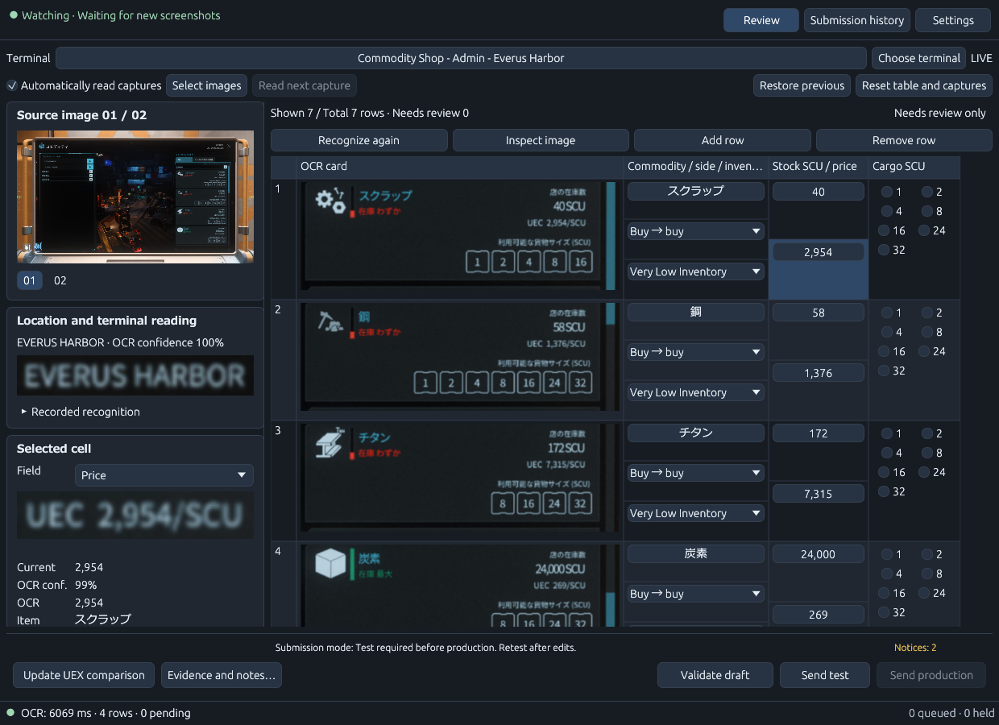
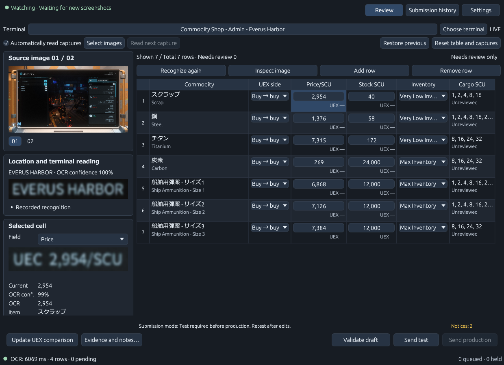
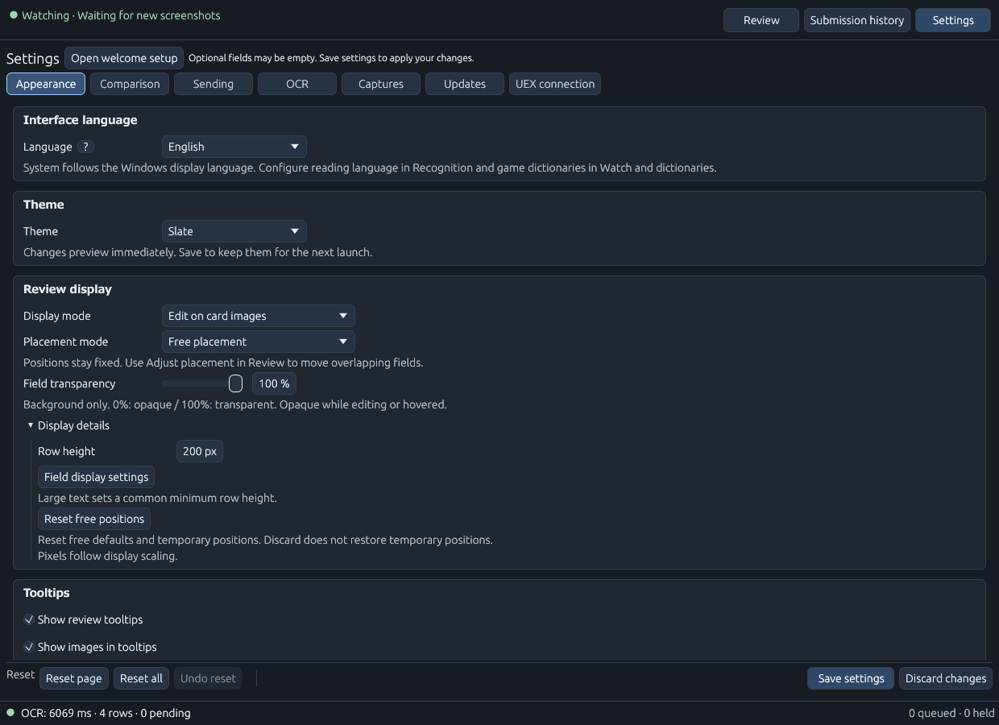
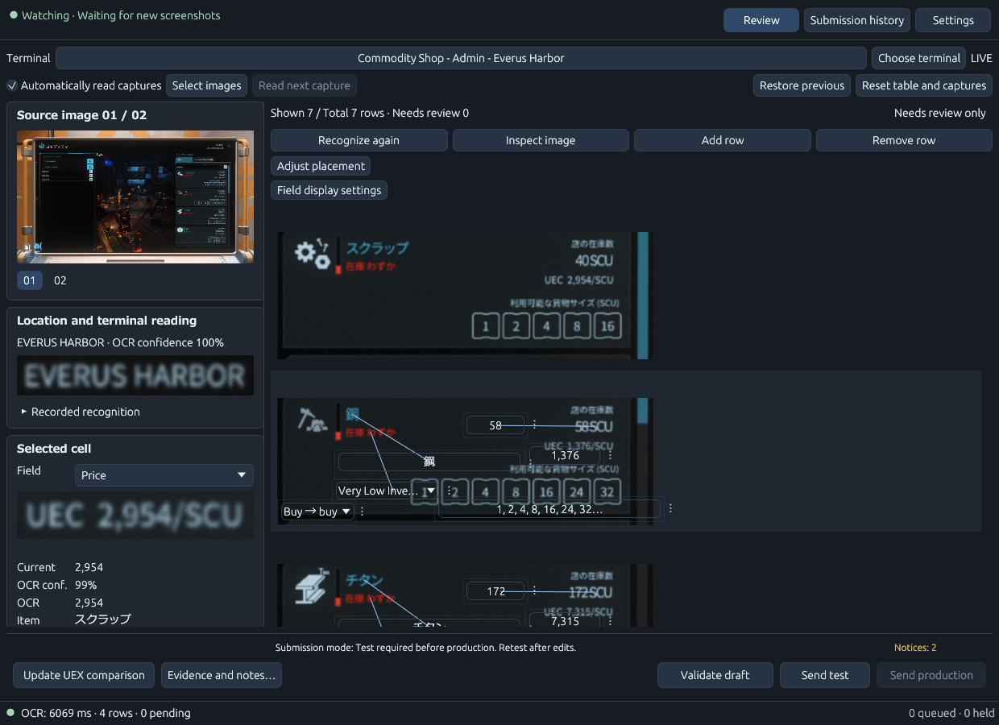
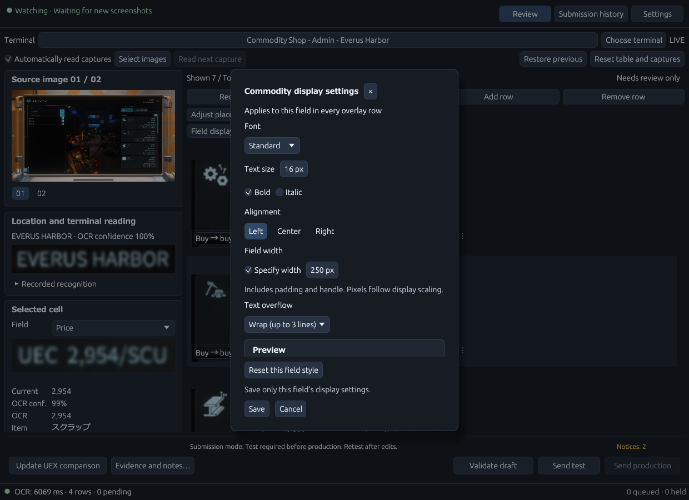

# Quick start

[README](../README.md) · [日本語](QUICKSTART.ja.md)

This guide covers **0.6.8**. Recognition of red trading terminals at
some **STANTON** locations and orange **Pyro** terminals remains preliminary.
Review names, prices, stock and cargo sizes against the image before submitting.

## 1. Install and set up

Download `VerseTrade-Relay.exe` from [Releases](https://github.com/nakacch/VerseTrade-Relay/releases)
and double-click it. Required support files and license notices are prepared
automatically in your user data folder. Microsoft Visual C++ x64 runtime must already be installed.

In welcome setup, choose the environment you play in (**LIVE** or **PTU**).
Use **Find standard game installations** or **Browse game folder** to find your
installed game's translation files. Set **LIVE global.ini** or **PTU global.ini**
to the `global.ini` for the language you use in that installation. For example,
a localization file is under `<game installation>/data/Localization/<language>/global.ini`.

If the active installation has no external `global.ini`, the app uses its bundled
English vocabulary. For another game language, select that language's file.
Leave the other environment empty if you do not use it.

The app uses entries in this translation file to match localized place and item
names to UEX, and automatically follows changes to the file while running.
The app interface language and game/OCR language are separate settings.
ONNX is the recommended OCR option. Select models suitable for your game language,
then use **download and verify** in the app's welcome setup or **Settings → OCR**.

In **Settings → OCR**, choose automatic language selection from the active
dictionary or a manual reading language. **Configure language models…** opens
the per-language editor. Changing its target language only changes which model
settings you edit. Choose ONNX or Tesseract, download/validate a model or select
an external Tesseract model, then use **Apply to settings** and **Save settings**.
**Reset this language** resets only that language's model choices. **Cancel**
discards dialog edits. Model downloads do not save your settings automatically.

ONNX support is included in the EXE, and the app downloads your selected models
for you. You can reopen first-run setup from Settings.

In Settings, refresh the UEX commodity and terminal catalog. Your **UEX user secret**
is required to submit reports to UEX. Enter it in **Settings → UEX connection**
when you plan to submit reports. It is not needed to download the public
commodity and terminal catalog. Set the **watch folder**
to the folder where the game saves screenshots, confirm the environment and
optional game version, then save settings. Saving does not
download models. Model downloads and catalog refreshes are separate operations.

## 2. Read and review

### The default view


First launch uses **Edit on card images**, with **Free placement**, **100% field
background transparency** and **200 px rows**. Commodity, price, stock, trade side,
inventory status and cargo controls sit over each card. Existing saved display,
layout and text preferences take priority. Hover or focus a transparent control
to make its background opaque.

Check the terminal, LIVE/PTU and monitoring status at the top. The upper left shows
the viewed source image; the lower left shows the selected field's crop, OCR value,
observations and editing controls. The commodity list scrolls vertically on the
right. The details have their own scrollbar, and validation/submission controls
stay at the bottom. Click the terminal name or **Choose terminal** if the detected
location is wrong. Candidates are left-aligned and emphasize differing parts of
their names. Correct automatic detection does not need manual confirmation.

### Consecutive captures and evidence


In this example, the first capture produces four rows for **Everus Harbor**.
Scroll the in-game list and take another screenshot at the same terminal: when
recognized as that terminal, the app adds new commodities to the current list.
The example grows to **seven rows and two images**. Carbon appears in both captures
and is kept as one row. Existing rows remain in place.


In **Standard table**, hover a cell to inspect the **image crop supporting that
value** and its OCR confidence. Enable **Show review tooltips** and **Show images
in tooltips** in **Settings → Appearance** if they are off. Card controls use compact
source/comparison hints; select a control for its crop and OCR confidence in the
left details. Individual fields can have evidence from different captures.
Click a source image or crop to enlarge it. The examples use Japanese game/OCR
language with the English UI.

1. Check that the app is watching your screenshot folder and that LIVE/PTU matches
   the environment you are playing in.
2. On the **in-game trading terminal**, set the **location field on the left** to
   the station name.
3. Take screenshots while scrolling through the **commodity list on the right of
   that same terminal**. With **Automatically read captures** enabled, the app
   reads these screenshots continuously as they appear in the watched folder.
   Normally, no terminal selection in the app or manual image import is needed.
4. Select a card control or table cell to inspect its source image, crop, OCR observations and
   candidate values. Correct the commodity, UEX direction, price per SCU, stock SCU,
   inventory status and cargo sizes as necessary. Status runs from 1 (empty) to 7 (full).
5. Review uncertain readings, pending items and UEX differences. The review filter
   only changes displayed rows; it does not remove hidden rows from submission.
6. Use image enlargement for unreadable details. Changing the viewed image does
   not automatically change the image attached to a report. Check attachments explicitly.

To correct cargo sizes, select the card's cargo control or the **Cargo SCU** cell, then select any combination
of 1, 2, 4, 8, 16, 24 and 32 SCU in the left details and press **Confirm cargo sizes**.
Scroll the details on smaller windows. **Cancel cargo edits** discards the pending
selection. **Omit cargo sizes** omits only the size declaration, leaving price and
inventory reporting available. Unreviewed OCR sizes are not sent automatically;
an empty selection is never reported as no available sizes.
Confirmed sizes belong to each row and survive rereading and page changes.
Different size sets may require separate requests. The submission confirmation
shows the sizes per commodity. Automatic correction comments remain paused.

In **Table with card images**, you can also confirm sizes directly with the cargo
checkboxes. Clearing all checks omits the size declaration. Leaving the controls
untouched does not confirm unreviewed OCR sizes.

A pencil marker identifies a value changed by the reporter, including adopting a
different OCR candidate or observation. Hover over the marker to inspect the reason
and the recorded before/after values. Confirming an unchanged value does not create
a reporter-change marker. Reverting to the original value removes that change's marker.

Automatic explanations of reporter changes and dictionary conversions are
temporarily disabled, regardless of OCR confidence or dictionary source.
Your own notes are still sent. Recorded evidence and change reasons remain available locally.

### Warning colors and changes between captures

| Display | Meaning and action |
| --- | --- |
| OCR confidence text color | Reading confidence; inspect the crop and OCR value. |
| UEX comparison border | A difference from reference price/stock; inspect details or hints. |
| Red value and border, with before/after explanation | Later captures disagree on price, stock or inventory status. |
| Pencil marker | A reporter edit, recorded separately from automatic updates. |

If a later price, stock or inventory reading differs and has at least **85% OCR
confidence**, the app adopts it and marks the field for review. Manually edited
or reviewed values are protected, with a disagreement notice. Select an unresolved
change to see **the earlier crop above the later crop** in the left details.
Click either to enlarge its source and inspect why the value was adopted or
protected. Missing evidence is identified rather than reconstructed.
Use **Mark this field reviewed**, edit the value or adopt an observation/candidate
to acknowledge known changes for that field. New disagreements can alert again.

Manual corrections do not make the original OCR observation more confident.
Re-recognition can update machine readings while preserving manual edits; verify
the resulting draft. Reset/clear operations can remove the current work.

You can also use **Select images** or drag and drop existing screenshots onto the
app. Folder watching detects new files, so use these options for older screenshots.
If a new image needs its destination confirmed, follow the on-screen prompt.

### Switch between three review displays

Choose **Settings → Appearance → Review display → Display mode**, then **Save
settings**. Only the selected mode's controls are shown. Switching preserves
review values, selection, evidence and report attachments.

| Display mode | Use | Initial row height |
| --- | --- | --- |
| Edit on card images (default) | Edit controls over each image, close to the original text. | 200 px |
| Table with card images | Image and editing columns side by side; **Stack fields** starts enabled. | 150 px |
| Standard table | Conventional columns for commodity, side, price, stock and other values. | 54 px |



The image table uses a shared card scale based on row height. Scroll horizontally
to reach columns that do not fit. Cargo checkboxes work directly in the table.



Card images use OCR's perspective correction. Individual values can come from
other captures, so also inspect the selected field's details. Older captures
without correction information may need rereading.

### Card placement and temporarily hiding controls



Image editing has four placement modes. **Display details** contains row height
and position reset for the selected display.

| Placement mode | Behavior |
| --- | --- |
| Free placement (default) | Keeps the chosen positions and allows overlap. |
| Avoid image text | Automatically uses text positions and available space. |
| Over recognized text | Follows recognized text; fields cannot be moved manually. |
| Fixed grid | Starts from a regular arrangement, adjustable with handles. |

Free placement and text overlays allow background transparency from 0% (opaque)
to 100% (transparent). Text and warning borders remain visible; hovered or focused
controls get opaque backgrounds.



**Hold the right mouse button on a card image** to hide that card's controls until
release. Click an image to enlarge it. These actions preserve values and placement.

Where the field layout provides handles, drag a handle to move its control
temporarily on that card. Hold Ctrl when
starting the drag to save that field's shared position across cards and restarts.
Esc cancels; focused handles also support arrow keys (Shift for larger steps,
Ctrl to save a shared position). Reset shared positions in the layout settings.
Reset clears shared and temporary positions; discarding settings does not restore
temporary positions. These display changes preserve values and report attachments.

Free placement keeps fields where you put them and permits overlap. Use **Adjust
placement** in Review and **Move item** to select and move a hidden field, then
choose **Finish placement** to resume editing. Free positions are saved separately
from text avoidance and the fixed grid. At 100% transparency, text can be hard to
read; hover, focus, or reduce transparency to inspect values.

Dragging a displayed numeric value does not change it. Click the number to type
an edit; keyboard steps and slider bars remain available.

### Field text styles



Open **Field display settings** above the card list or under **Display details**,
then choose commodity, price, stock or another field kind. Preview the font, size
(8–36 px), bold/italic, alignment, width and overflow. Each style applies to **that
field kind across all overlay rows**. Wrapping supports up to three lines; numeric
price and stock fields cannot wrap. Unavailable fonts use Standard for display.
Scroll the dialog body to reach the preview; Save and Cancel stay at the bottom.

The dialog's **Save** saves **only that field's display settings**, leaving other
pending settings untouched. **Cancel**, × or Esc restores the previous style.
**Reset this field style** previews the default; use **Save** to keep it. Styling
does not change OCR values, report contents or a successful test's validity.

## 3. Testing (optional) and production submission

Testing is **optional, depending on the submission mode**. To skip it, select
**Test optional** or **Production only** in **Settings → Sending** and save.
The default test-first mode requires a successful test.


After a successful test of the same contents, **Send production** opens this final
confirmation in the default mode. Check the destination and attached image before
using **Send to production**. The illustration uses a simulated test response.

Check the terminal, environment, direction, game version, report values and supporting
image. **A screenshot is required for every report, including test submissions;
attachment cannot be disabled.** The app attaches the original capture converted
to JPEG, not the image corrected for OCR. Missing or changed evidence blocks submission.
Use input validation to resolve blocking errors. Check the selected
submission mode: the default test-first mode requires a successful test of the
same contents before production. In this mode, changes to tested values or
user-entered notes require another test.
Other modes follow the controls and confirmation shown in the app.

UEX requests follow the saved game language, independently of the app interface
language. Automatic report comments are temporarily disabled,
regardless of the interface language.

Test submission contacts UEX when run from the app; it is separate from production
reporting. Confirm production only after reviewing the summary. Keep the app open
until the result is known. PTU drafts are not submitted as LIVE reports.

If a production request has an **unknown** result, do not submit the same report
again immediately. In **History**, filter unknown entries, refresh status and use
reconciliation. Supply all report IDs for the group or confirm that the entire
group was not accepted before recovery. A partial result is not proof of rejection.

## 4. Settings and history

Settings has seven groups of tabs: appearance/images, UEX comparison, submission,
OCR, monitoring/language, app updates and UEX connection.

| Tab | Main controls |
| --- | --- |
| Appearance | UI language, theme, review display/placement/styles and tooltips. |
| Comparison | Reference retrieval and price/stock comparisons. |
| Sending | Test-first, optional-test and production-only modes; behavior after sending. |
| OCR | Automatic/manual reading language, per-language models and OCR aliases. |
| Captures | LIVE/PTU, watch folder and each environment's game translation file. |
| Updates | Check/download updates, notifications and skipped versions. |
| UEX connection | User secret and commodity/terminal catalog refresh. |

Resetting a page affects
that page's unsaved edits; all-settings reset is broader. Undo reset, Save and the
unsaved-changes prompt let you choose what to keep. Themes preview immediately.

### Register recurring OCR mistakes

Open **OCR → User OCR reading dictionary → Edit reading dictionary**, then **Add reading entry**. Choose
commodity, location, terminal or inventory status and the correct target. Check
the game language and LIVE/PTU scope, then enter one OCR spelling per line.
Inventory entries also need the buying/selling direction. Approximate matching
is set per spelling and starts off for new entries.

Use **Save dictionary** to commit entries. The dictionary saves separately from
app preferences; **Save settings** does not save it. The list and editor scroll
independently, with a draggable divider. Disable or delete incorrect entries and
save again. Original OCR text remains available for reviewing evidence/candidates.

### Recover folder monitoring

If the top status shows a monitoring error, open **Watch details** to inspect the
saved folder and error. **Open watch settings** takes you to **Captures** to correct
and save the path. Monitoring resumes automatically when the folder becomes
readable. Use **Select images** for existing captures.

### Submission history

History is a separate page with all/test/production/unknown filters and report
status tools. Preserve history during updates, especially unresolved submissions.


These are simulated entries with illustrative report IDs. A pending production
entry is not an approval; use **Check status** to follow its status in real use.
For a motion overview, return to the [README demo](../README.md#see-it-in-action).

## 5. Update, backup and uninstall

Close the app before updating. Back up `%APPDATA%\VerseTrade-Relay\`, download the
new EXE, verify its checksum and save it into a new folder. Launch the
new EXE. Existing user data is separate from the executable.

The app checks published GitHub releases at startup.
New versions can be downloaded and verified from **Settings → Updates**; installation
is manual. Minor/patch notifications can be disabled or a version skipped. Major
updates are announced at each startup and cannot be skipped.
No GitHub token is entered into the app.

To verify the executable in PowerShell:

```powershell
Get-FileHash .\VerseTrade-Relay.exe -Algorithm SHA256
```

Compare it with the matching `.exe.sha256` asset from the same release.
Checksums detect differing bytes; the app is unsigned.

Your UEX user secret is protected by **Windows data protection**.
Backups contain private history, paths and protected credentials: keep them private.

To uninstall:

1. Close VerseTrade Relay.
2. Delete **`VerseTrade-Relay.exe`** from the folder where you saved it.
3. In File Explorer, delete **`%APPDATA%\VerseTrade-Relay\`** to remove settings,
   submission history and downloaded models. Back up any data you want to keep first.
4. To also remove cached image copies and support files, delete
   **`%LOCALAPPDATA%\VerseTrade-Relay\`**.

## Troubleshooting

| Symptom | Action |
| --- | --- |
| Missing OCR models | Choose your engine/language/model and download/verify in welcome setup or OCR settings. |
| Required support files fail to load | Install Microsoft's x64 Visual C++ runtime; clear an obsolete explicit DLL setting, close and restart. Check cache write access. |
| Missing Japanese text | Check that Japanese-capable Windows UI fonts are installed. Fonts are not bundled. |
| Incorrect names/locations | Check the selected localization, environment, catalog and terminal; inspect observations and candidates. |
| The display differs from this guide | Saved preferences take priority. Choose a display under Appearance → Review display and save. |
| Card controls overlap | Use Adjust placement to select and move a field, or change display/transparency. Hold the right mouse button to inspect the image text. |
| New captures are not imported | Check monitoring status/Watch details, the saved folder and automatic reading. Import existing images manually. |
| Submit is disabled | Resolve validation errors, pending items, missing credentials or a missing/stale successful test in a test-required mode; inspect the shown reason. |
| Unknown production result | Reconcile in History before attempting a resend. |
| App closes unexpectedly | Check `%APPDATA%\VerseTrade-Relay\logs\versetrade-relay.log` and report the version and reproduction steps. |

Report issues in [VerseTrade-Relay Issues](https://github.com/nakacch/VerseTrade-Relay/issues).
Redact secrets and personal information from any logs or screenshots you share.
