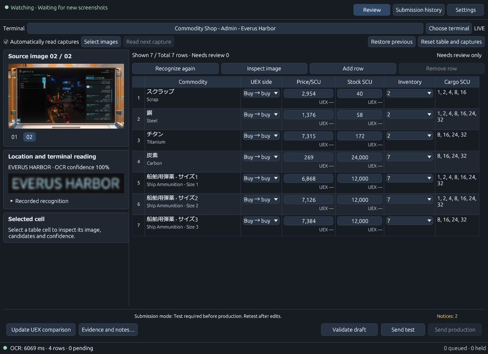
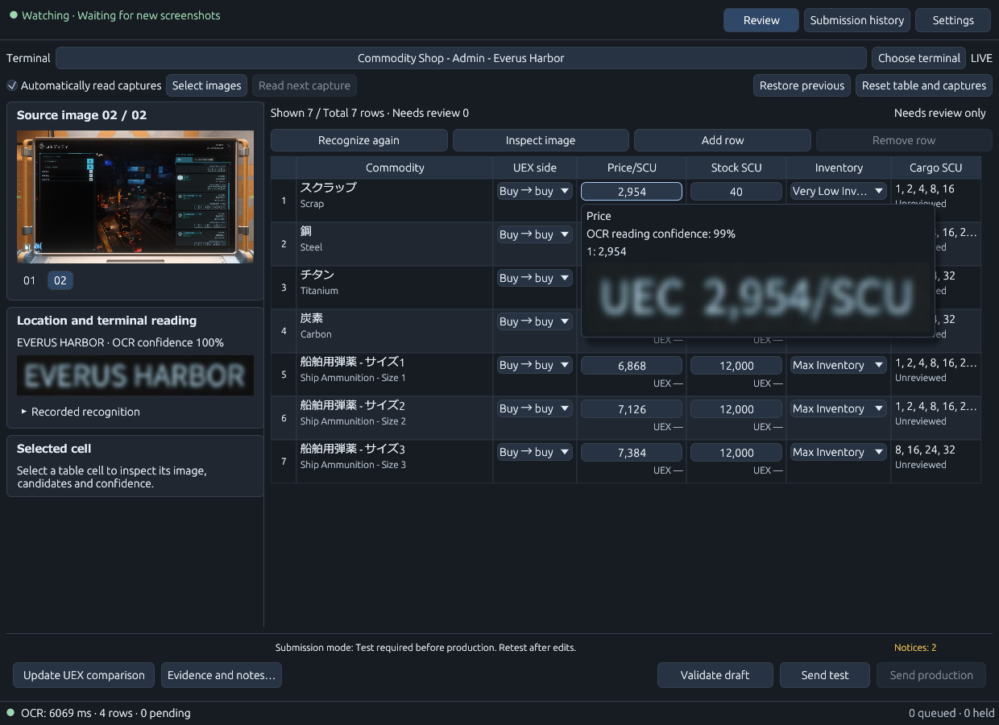
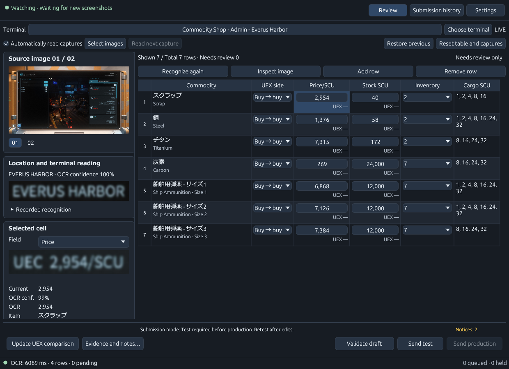
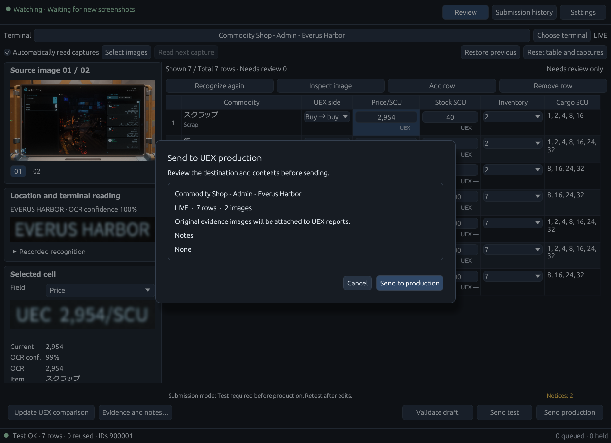
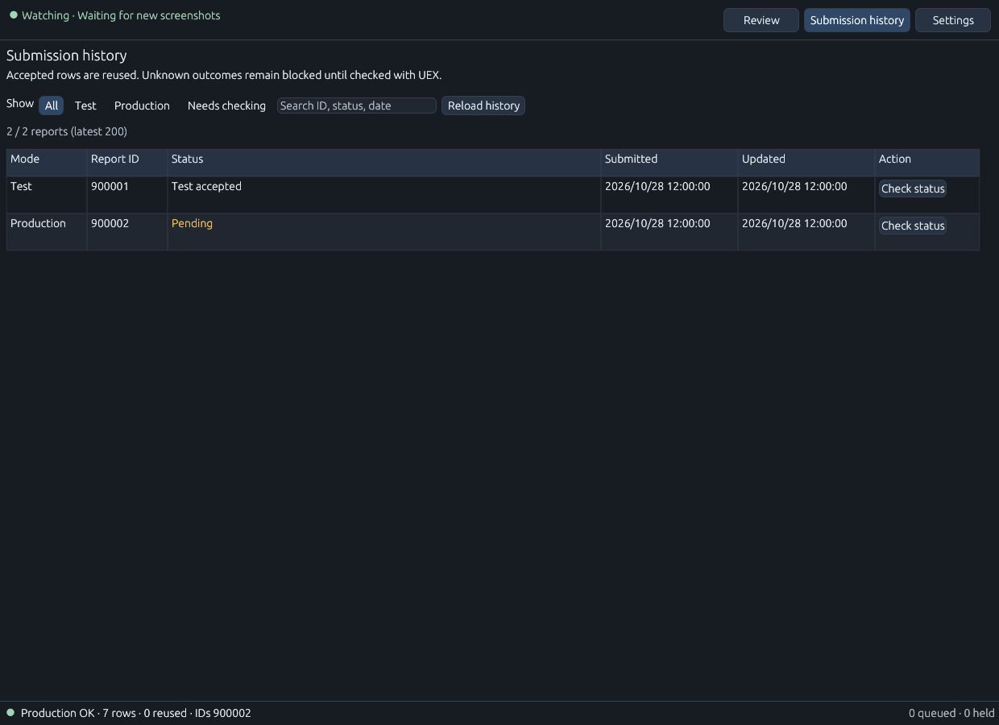

# Quick start

[README](../README.md) · [日本語](QUICKSTART.ja.md)

## 1. Install and set up

Download `VerseTrade-Relay.exe` from [Releases](https://github.com/nakacch/VerseTrade-Relay/releases)
and double-click it. Required support files and license notices are prepared
automatically in your user data folder. Microsoft Visual C++ x64 runtime must already be installed.

In welcome setup, choose the environment you play in (**LIVE** or **PTU**).
Use **Find standard game installations** or **Browse game folder** to find your
installed game's translation files. Set **LIVE global.ini** or **PTU global.ini**
to the `global.ini` for the language you use in that installation. For example,
a localization file is under `<game installation>/data/Localization/<language>/global.ini`.

If the active installation has no external `global.ini`, the app uses its bundled
English vocabulary. For another game language, select that language's file.
Leave the other environment empty if you do not use it.

The app uses entries in this translation file to match localized place and item
names to UEX, and automatically follows changes to the file while running.
The app interface language and game/OCR language are separate settings.
ONNX is the recommended OCR option. Select models suitable for your game language,
then use **download and verify** in the app's welcome setup or **Settings → OCR**.

In **Settings → OCR**, choose automatic language selection from the active
dictionary or a manual reading language. **Configure language models…** opens
the per-language editor. Changing its target language only changes which model
settings you edit. Choose ONNX or Tesseract, download/validate a model or select
an external Tesseract model, then use **Apply to settings** and **Save settings**.
**Reset this language** resets only that language's model choices. **Cancel**
discards dialog edits. Model downloads do not save your settings automatically.

ONNX support is included in the EXE, and the app downloads your selected models
for you. You can reopen first-run setup from Settings.

In Settings, refresh the UEX commodity and terminal catalog. Your **UEX user secret**
is required to submit reports to UEX. Enter it in **Settings → UEX connection**
when you plan to submit reports. It is not needed to download the public
commodity and terminal catalog. Set the **watch folder**
to the folder where the game saves screenshots, confirm the environment and
optional game version, then save settings. Saving does not
download models. Model downloads and catalog refreshes are separate operations.

## 2. Read and review



In this example, the first capture produces four rows for **Everus Harbor**.
Scroll the in-game list and take another screenshot at the same terminal: when
recognized as that terminal, the app adds new commodities to the current list.
The example grows to **seven rows and two images**. Carbon appears in both captures
and is kept as one row. Existing rows remain in place.



Hover an individual cell to inspect the **image crop supporting that value** and
its OCR confidence. Enable **Show review tooltips** and **Show images in tooltips**
in **Settings → Appearance** if they are off. These images follow each cell's evidence, which can come from
different captures as the list grows.



The selected price is highlighted in the table; its source crop and OCR value
appear on the left. The original image stays above it, and validation/submission
controls remain at the bottom. Click the image for a larger view and select cells
to check each value. The example's game/OCR language is Japanese; the UI is English.

1. Check that the app is watching your screenshot folder and that LIVE/PTU matches
   the environment you are playing in.
2. On the **in-game trading terminal**, set the **location field on the left** to
   the station name.
3. Take screenshots while scrolling through the **commodity list on the right of
   that same terminal**. With **Automatically read captures** enabled, the app
   reads these screenshots continuously as they appear in the watched folder.
   Normally, no terminal selection in the app or manual image import is needed.
4. Select a table cell to inspect its source image, crop, OCR observations and
   candidate values. Correct the commodity, UEX direction, price per SCU, stock SCU,
   inventory status and cargo sizes as necessary. Status runs from 1 (empty) to 7 (full).
5. Review uncertain readings, pending items and UEX differences. The review filter
   only changes displayed rows; it does not remove hidden rows from submission.
6. Use image enlargement for unreadable details. Changing the viewed image does
   not automatically change the image attached to a report. Check attachments explicitly.

To correct cargo sizes, select the **Cargo SCU** cell, then select any combination
of 1, 2, 4, 8, 16, 24 and 32 SCU in the left details and press **Confirm cargo sizes**.
Scroll the details on smaller windows. **Cancel cargo edits** discards the pending
selection. **Omit cargo sizes** omits only the size declaration, leaving price and
inventory reporting available. Unreviewed OCR sizes are not sent automatically;
an empty selection is never reported as no available sizes.
Confirmed sizes belong to each row and survive rereading and page changes.
Different size sets may require separate requests. Manual corrections receive
automatic English notes; the submission confirmation shows sizes and notes per commodity.

A pencil marker identifies a value changed by the reporter, including adopting a
different OCR candidate or observation. Hover over the marker to inspect the reason
and the recorded before/after values. Confirming an unchanged value does not create
a reporter-change marker. Reverting to the original value removes that change's marker.

Reports automatically include English explanations of applicable reporter changes
and recorded dictionary conversions. Quoted OCR/dictionary text keeps its original
language. These explanations are added alongside your own notes. An annotated item
may be sent as an individual report, so more annotated items can mean more requests.

OCR confidence text colors and UEX difference borders represent different checks.
Low OCR confidence changes the value's text color; UEX price/stock differences
are shown with colored borders and difference values.
Manual corrections do not make the original OCR observation more confident.
Re-recognition can update machine readings while preserving manual edits; verify
the resulting draft. Reset/clear operations can remove the current work.

You can also use **Select images** or drag and drop existing screenshots onto the
app. Folder watching detects new files, so use these options for older screenshots.
If a new image needs its destination confirmed, follow the on-screen prompt.

## 3. Testing (optional) and production submission

Testing is **optional, depending on the submission mode**. To skip it, select
**Test optional** or **Production only** in **Settings → Sending** and save.
The default test-first mode requires a successful test.



After a successful test of the same contents, **Send production** opens this final
confirmation in the default mode. Check the destination and attached image before
using **Send to production**. The illustration uses a simulated test response.

Check the terminal, environment, direction, game version, report values and supporting
image. **A screenshot is required for every report, including test submissions;
attachment cannot be disabled.** The app attaches the original capture converted
to JPEG, not the image corrected for OCR. Missing or changed evidence blocks submission.
Use input validation to resolve blocking errors. Check the selected
submission mode: the default test-first mode requires a successful test of the
same contents before production. In this mode, changes to tested values or generated report
explanations require another test.
Other modes follow the controls and confirmation shown in the app.

UEX requests follow the saved game language, independently of the app interface
language. Automatically generated explanations remain in English.

Test submission contacts UEX when run from the app; it is separate from production
reporting. Confirm production only after reviewing the summary. Keep the app open
until the result is known. PTU drafts are not submitted as LIVE reports.

If a production request has an **unknown** result, do not submit the same report
again immediately. In **History**, filter unknown entries, refresh status and use
reconciliation. Supply all report IDs for the group or confirm that the entire
group was not accepted before recovery. A partial result is not proof of rejection.

## 4. Settings and history

Settings has seven groups of tabs: appearance/images, UEX comparison, submission,
OCR, monitoring/language, app updates and UEX connection. Resetting a page affects
that page's unsaved edits; all-settings reset is broader. Undo reset, Save and the
unsaved-changes prompt let you choose what to keep. Themes preview immediately.

History is a separate page with all/test/production/unknown filters and report
status tools. Preserve history during updates, especially unresolved submissions.



These are simulated entries with illustrative report IDs. A pending production
entry is not an approval; use **Check status** to follow its status in real use.
For a motion overview, return to the [README demo](../README.md#see-it-in-action).

## 5. Update, backup and uninstall

Close the app before updating. Back up `%APPDATA%\VerseTrade-Relay\`, download the
new EXE, verify its checksum and save it into a new folder. Launch the
new EXE. Existing user data is separate from the executable.

The app checks published GitHub releases at startup. Once distribution is public,
new versions can be downloaded and verified from **Settings → Updates**; installation
is manual. Minor/patch notifications can be disabled or a version skipped. Major
updates are announced at each startup and cannot be skipped. While the repository
is private, anonymous checks find no update: download from Releases using your
authorized GitHub account. No GitHub token is entered into the app.

To verify the executable in PowerShell:

```powershell
Get-FileHash .\VerseTrade-Relay.exe -Algorithm SHA256
```

Compare it with the matching `.exe.sha256` asset from the same release.
Checksums detect differing bytes; the app is unsigned.

Your UEX user secret is protected by **Windows data protection**.
Backups contain private history, paths and protected credentials: keep them private.

To uninstall:

1. Close VerseTrade Relay.
2. Delete **`VerseTrade-Relay.exe`** from the folder where you saved it.
3. In File Explorer, delete **`%APPDATA%\VerseTrade-Relay\`** to remove settings,
   submission history and downloaded models. Back up any data you want to keep first.
4. To also remove cached image copies and support files, delete
   **`%LOCALAPPDATA%\VerseTrade-Relay\`**.

## Troubleshooting

| Symptom | Action |
| --- | --- |
| Missing OCR models | Choose your engine/language/model and download/verify in welcome setup or OCR settings. |
| Required support files fail to load | Install Microsoft's x64 Visual C++ runtime; clear an obsolete explicit DLL setting, close and restart. Check cache write access. |
| Missing Japanese text | Check that Japanese-capable Windows UI fonts are installed. Fonts are not bundled. |
| Incorrect names/locations | Check the selected localization, environment, catalog and terminal; inspect observations and candidates. |
| Submit is disabled | Resolve validation errors, pending items, missing credentials or a missing/stale successful test in a test-required mode; inspect the shown reason. |
| Unknown production result | Reconcile in History before attempting a resend. |
| App closes unexpectedly | Check `%APPDATA%\VerseTrade-Relay\logs\versetrade-relay.log` and report the version and reproduction steps. |

Report issues in [VerseTrade-Relay Issues](https://github.com/nakacch/VerseTrade-Relay/issues).
Redact secrets and personal information from any logs or screenshots you share.
